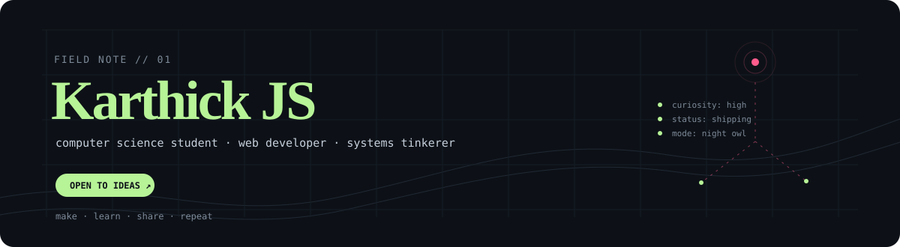

<div align="center">
  
</div>

<br />

<table>
  <tr>
    <td width="62%" valign="top">

### Hello, I’m Karthick JS.

I’m a Computer Science student and web developer who likes turning vague ideas into useful interfaces — then taking the long way around to understand how the pieces work.

Right now I’m exploring the overlap between **frontend craft**, **backend experiments**, and the small tools that make everyday work feel lighter.

  </td>
  <td width="38%" valign="top">

```txt
┌─ currently ───────────┐
│ learning in public    │
│ shipping small things │
│ following rabbit holes│
└───────────────────────┘
```

  </td>
  </tr>
</table>

<p align="center">
  <a href="mailto:jskarthick399@gmail.com"></a>
  &nbsp;
  <a href="https://github.com/Karthick-1905"></a>
</p>

<br />

## / what I’m about

I care about the space between **“it works”** and **“it feels good to use.”** That usually means thoughtful UI, readable code, and enough curiosity to look under the hood.

I’m happiest when a project lets me move across the stack: shaping a screen, wiring an API, modelling the data, and leaving the codebase a little kinder than I found it.

<table>
  <tr>
    <td>01&nbsp;&nbsp; <strong>Make it clear</strong><br /><sub>Simple interfaces, useful defaults, no mystery meat.</sub></td>
    <td>02&nbsp;&nbsp; <strong>Stay curious</strong><br /><sub>Learn the tool, not just the tutorial.</sub></td>
    <td>03&nbsp;&nbsp; <strong>Ship the loop</strong><br /><sub>Small experiments become real things.</sub></td>
  </tr>
</table>

## / selected signals

<table>
  <tr>
    <td width="50%" valign="top">

### VitaLink

Healthcare, but more human. A mobile application exploring a clearer way to connect patients with hospital information.

`React Native` `Expo` `TypeScript`

→ [open the repository](https://github.com/Karthick-1905/Psg_hospital_inr_app)

  </td>
    <td width="50%" valign="top">

### LUNA

An edge-native podcast creation and editing project built with a team — a good excuse to think about local-first AI and creative tools.

`AI` `Python` `Desktop`

→ [see the project](https://github.com/SuryaNarayanaa/LUNA-QUALCOMM-EDGE-AI)

  </td>
  </tr>
</table>

<p align="center">
  <a href="https://awsnap.dev/globe/pet"></a>
  <br />
  <sub>Blip keeps watch over the field notes.</sub>
</p>

## / toolkit

<p>
  
  <br />
  
</p>

<br />

## / contribution weather

<p>
  
  
</p>

<p>
  
</p>

<details>
  <summary><strong>peek at the year</strong></summary>
  <br />
  
</details>

<br />

<p align="center">
  <sub>Thanks for stopping by. If something here sparks an idea, <a href="mailto:jskarthick399@gmail.com">say hello</a>.</sub>
</p>
